# Question 1: Knowledge Graph Architecture & Hand-Drawn Sketch Guide

This document provides both the **Mermaid diagram** of the loan reasoning graph and a step-by-step guide for creating the **hand-drawn sketch** required for the submission.

---

## 1. Mermaid Architecture Diagram

```mermaid
flowchart TD
    %% Styling
    classDef borrower fill:#2C3E50,stroke:#1A252F,stroke-width:2px,color:#FFFFFF;
    classDef fact fill:#2980B9,stroke:#1B4F72,stroke-width:2px,color:#FFFFFF;
    classDef tacit fill:#D35400,stroke:#873600,stroke-width:2px,color:#FFFFFF;
    classDef infer fill:#8E44AD,stroke:#512E5F,stroke-width:2px,color:#FFFFFF;
    classDef conseq fill:#F39C12,stroke:#B9770E,stroke-width:2px,color:#FFFFFF;
    classDef risk fill:#C0392B,stroke:#78281F,stroke-width:2px,color:#FFFFFF;
    classDef decision fill:#27AE60,stroke:#145A32,stroke-width:2px,color:#FFFFFF;

    subgraph APEX_CASE ["CASE A: APEX LOGISTICS (REJECTED)"]
        A_BORROWER["Borrower: Apex Logistics Ltd.<br>(Credit: 742, Collateral: $320k)"]:::borrower
        A_FACT["Application Fact:<br>84% Revenue via Retailer TitanMart"]:::fact
        A_TACIT["Tacit Knowledge:<br>TitanMart PE Buyout & 90-Day Payment Term Squeeze"]:::tacit
        A_INFER["Inferred Assessment:<br>Monopsony Price-Taker Fragility"]:::infer
        A_CONSEQ["Financial Consequence:<br>Working Capital Freeze & DSCR Collapses to 0.38x"]:::conseq
        A_RISK["Repayment Risk:<br>Severe Default Risk within 9 Months"]:::risk
        A_DECISION["Decision:<br>REJECT APPLICATION"]:::decision

        A_BORROWER -->|has_stated_fact| A_FACT
        A_FACT -->|triggers_tacit_knowledge| A_TACIT
        A_TACIT -->|infers| A_INFER
        A_INFER -->|leads_to_consequence| A_CONSEQ
        A_CONSEQ -->|determines_risk| A_RISK
        A_RISK -->|justifies_decision| A_DECISION
    end

    subgraph BEACON_CASE ["CASE B: BEACON PRECISION (APPROVED)"]
        B_BORROWER["Borrower: Beacon Precision Ltd.<br>(Credit: 738, Collateral: $310k)"]:::borrower
        B_FACT["Application Fact:<br>Q2 Cash Dip (-$65k) for ISO-13485 Audit"]:::fact
        B_TACIT["Tacit Knowledge:<br>Medical Device Certification = Sticky Multi-Year Moat"]:::tacit
        B_INFER["Inferred Assessment:<br>Diversified Base (22 Clients) & Pricing Power"]:::infer
        B_CONSEQ["Financial Consequence:<br>Signed Purchase Orders Surge DSCR to 2.15x"]:::conseq
        B_RISK["Repayment Risk:<br>High Debt-Service Capacity & Cash Buffer"]:::risk
        B_DECISION["Decision:<br>APPROVE APPLICATION"]:::decision

        B_BORROWER -->|has_stated_fact| B_FACT
        B_FACT -->|triggers_tacit_knowledge| B_TACIT
        B_TACIT -->|infers| B_INFER
        B_INFER -->|leads_to_consequence| B_CONSEQ
        B_CONSEQ -->|determines_risk| B_RISK
        B_RISK -->|justifies_decision| B_DECISION
    end
```

---

## 2. Guide to Draw the Hand-Drawn Sketch (for Submission Photo)

The submission requires:
> *"A photo of a hand-drawn sketch of your graph. A rough sketch is perfectly fine."*

### Step-by-Step Drawing Guide (5 minutes with pen & paper):

1. **Take a blank sheet of paper** (A4 or unruled notebook).
2. **Title at the top:**  
   `Loan Underwriting Knowledge Graph: Modeling Reasoning & Judgment`
3. **Divide the page into two vertical columns:**
   - Left column header: **Apex Logistics (Rejected)**
   - Right column header: **Beacon Precision (Approved)**
4. **Draw 5 boxes down each column, connected with downward arrows:**
   - **Box 1 (Top - Fact):**  
     - Left: `[Fact: 84% Rev from TitanMart]`  
     - Right: `[Fact: Q2 Cash Dip (-$65k) for ISO Audit]`
   - **Arrow 1:** Label with `triggers tacit knowledge`
   - **Box 2 (Tacit Knowledge - Clouds or Dashed Boxes):**  
     - Left: `[Tacit: TitanMart PE buyout, 90-day term extension]`  
     - Right: `[Tacit: ISO-13485 has 14-month qualification moat]`
   - **Arrow 2:** Label with `infers`
   - **Box 3 (Inferred Assessment):**  
     - Left: `[Assessment: Zero pricing power, extreme dependency]`  
     - Right: `[Assessment: 22 clients, sticky recurring contracts]`
   - **Arrow 3:** Label with `leads to financial impact`
   - **Box 4 (Financial Consequence):**  
     - Left: `[Consequence: Working capital hole $210k, DSCR -> 0.38x]`  
     - Right: `[Consequence: POs unlock, projected DSCR -> 2.15x]`
   - **Arrow 4:** Label with `determines default risk`
   - **Box 5 (Bottom - Final Decision):**  
     - Left: `[REJECT LOAN]` (Draw a cross or double box)  
     - Right: `[APPROVE LOAN]` (Draw a checkmark or double box)
5. **Add a small key/legend at the bottom corner:**  
   `Solid Box = Form Fact | Dashed/Cloud = Officer's Mind | Double Box = Decision`
6. Take a clear photo using your smartphone and save it as `diagrams/hand_drawn_q1_graph.jpg`.
