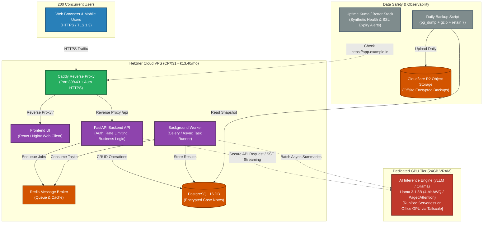

# Question 2: Cloud Setup Architecture & Hand-Drawn Diagram Guide

This document contains the **Mermaid system architecture diagram** and the step-by-step instructions for sketching the **hand-drawn setup diagram** required for the submission.

---

## 1. System Architecture Diagram (Mermaid)

---

## 2. Guide to Draw the Hand-Drawn Setup Diagram (for Submission Photo)

The assignment requires:
> *"Please also draw a simple diagram of your setup by hand (boxes and arrows on paper are enough) and take a photo of it."*

### Step-by-Step Drawing Guide (5 minutes with pen & paper):

1. **Take a blank paper (A4 or notebook).**
2. **Title at the top:**  
   `Cloud Architecture: 200 Users AI Case Management System (Llama 3.1 8B)`
3. **Draw 4 Main Boxes (from left to right or top to bottom):**

   - **Box 1 (Top / Left): Users**
     - Label: `200 Users (Web / Mobile)`
     - Draw an arrow labeled `HTTPS (Port 443)` pointing to Box 2.

   - **Box 2 (Large Outer Box): Cloud VPS (Hetzner CPX31 - Rs. 1,220/mo)**
     - Inside this large box, draw 5 interconnected boxes:
       - `[ Caddy Proxy ]` (Auto HTTPS / Port 80 & 443)
       - `[ Frontend (Web) ]` $\leftarrow$ connected to Caddy
       - `[ Backend (FastAPI) ]` $\leftarrow$ connected to Caddy
       - `[ PostgreSQL 16 ]` (Private Case Notes) $\leftarrow$ connected to Backend
       - `[ Background Worker + Redis ]` $\leftarrow$ connected to Backend & DB

   - **Box 3 (Right): AI GPU Tier (24GB VRAM)**
     - Label: `[ AI Model Engine: Llama 3.1 8B ]`
     - Notes inside box: `4-bit AWQ / vLLM Continuous Batching`
     - Label connection: `RunPod Serverless / Tailscale VPN`
     - Draw bidirectional arrow between `FastAPI Backend` and `AI Model Engine` (labeled `Streaming Token Inference`).

   - **Box 4 (Bottom): Data Safety & Monitoring**
     - Draw small box: `[ Backup Script (Daily, Retain 7) ]` pointing from `Postgres` to `[ Cloudflare R2 Offsite Storage ]`.
     - Draw small box: `[ Uptime Kuma ]` with dashed arrow pointing to `Caddy` (labeled `SSL & Health Alert`).

4. **Add a small cost & spec box in the corner:**  
   `Total Budget: Rs. 25,000/mo | Actual Cost: ~Rs. 7,200/mo | 99.99% Uptime`
5. Take a photo with your mobile camera and save as `diagrams/hand_drawn_q2_setup.jpg`.
